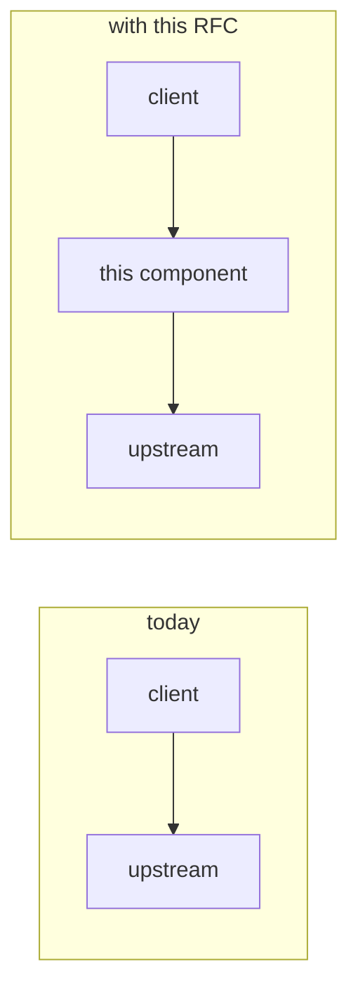
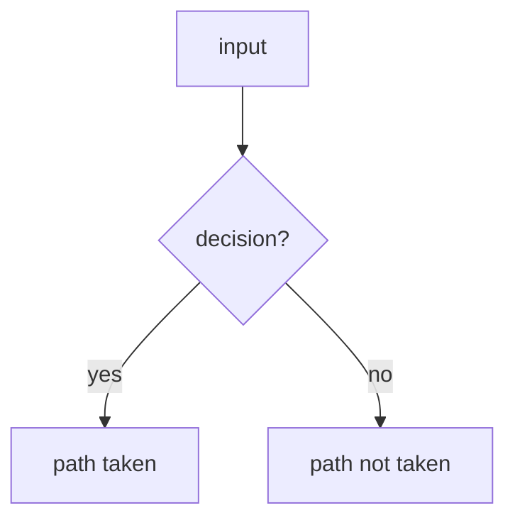
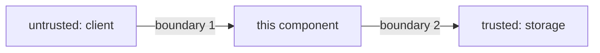

<!--
HOW TO USE THIS TEMPLATE

Copy this file to docs/rfc/NNNN-<slug>.md (or run `task rfc:new` where the
repo has it), fill it top to bottom, and delete every HTML comment, this one
included. What is left must read as a document, not a filled-in form.

- NNNN is one past the highest number that has ever existed, zero-padded to 4.
  Numbers are never reused, even by a rejected or withdrawn RFC.
- The slug describes the change, not the solution:
  `0002-artifact-retention-policies`, not `0002-add-a-cron-job`.
- Sections that genuinely do not apply are deleted and the numbering closed up,
  never left as "N/A". EXCEPT the blocks marked MANDATORY below: §6.P (proof),
  §7 (security), §8 (supply chain), §9 (data and privacy) and §10
  (operability). Those are always present. "None applies" is a valid answer
  inside them when it says why; a missing block is not, because a month later
  nobody can tell a decision from an omission.
- An RFC is for a change worth arguing about *before* it is written: new
  user-facing surface, a cross-component refactor, a security-relevant default,
  a new dependency or data flow, or anything expensive to undo. A bug fix is
  not an RFC.

STATUS VOCABULARY
  Draft            — being written; open questions still open
  In review        — open questions resolved AND every mandatory block written
  Accepted         — agreed; implementation may start
  Implemented      — merged; link the PRs/commits in the header
  Rejected         — decided against; keep the file, it records why
  Superseded by NNNN
-->

# RFC NNNN — <Title>

| Field       | Value                                                        |
| ----------- | ------------------------------------------------------------ |
| Status      | Draft                                                         |
| Short       | <How this is listed: a few words, no number>                  |
| Settles     | <One line: what this settles>                                 |
| Author      | Name <email>                                                  |
| Co-author   | —                                                             |
| Created     | YYYY-MM-DD                                                    |
| Supersedes  | —                                                             |
| Touches     | `crates/…`, `ui`, `helm`, `Containerfile`, docs               |
| Risk        | <low / medium / high — the highest rating in §7 to §10>       |

---

## 1. Summary

<!--
Three to six sentences. What changes, for whom, and what it looks like from the
outside. A reader who stops here should be able to describe the feature to
someone else. Show before telling: a config block, a CLI call, a client snippet.
-->

### Before / after

```text
# today

# with this RFC
```



<!-- One sentence under the diagram: what it proves. Mark the request that is
refused, rewritten or newly trusted. -->

---

## 2. Motivation

<!--
Numbered, strongest first, each falsifiable: it names the code path or workflow
that hurts today. "It would be cleaner" is not a motivation.
-->

1. **<Problem>.** <Why it hurts today, with the specific code path or workflow.>
2. …

---

## 3. Goals / non-goals

**Goals**

- <One capability per bullet, phrased as an outcome, not an implementation.>

**Non-goals**

<!-- The most useful section. Include what a reasonable reader would assume is
in scope, one clause each on why not. -->

- <Thing deliberately not done, and one clause on why.>

---

## 4. User-facing design

### 4.1 Configuration

```toml
[section]
option = "value"    # what it does
```

- <Defaults, and what "absent" means as distinct from "empty".>
- <Which defaults are security-relevant, and why the default is the safe one.>

### 4.2 Behaviour rules

- <Normalisation, precedence, and what happens in the uninteresting case.>

### 4.3 Validation

Rejected at startup / on input:

| Condition | Rationale |
| --- | --- |
| <what> | <why this must fail rather than degrade> |

Warnings, and where the operator actually sees them:

| Condition | Behaviour | Surfaced in |
| --- | --- | --- |
| <what> | <what happens instead of failing> | <admin page, metric, startup log> |

### 4.4 API surface

<!-- Delete if no API changes. Every endpoint added or changed: method, path,
auth required, who may call it, rate limit. In Rust the spec is generated by
utoipa — name the handler; on the front the client is regenerated with HeyApi. -->

| Method | Path | Auth | Who may call | Limit |
| --- | --- | --- | --- | --- |
| | | | | |

---

## 5. Architecture

<!-- Which layer does what. Name the existing types and functions extended.
Two to four mermaid diagrams; each carries a sentence saying what it proves.
State the invariant: "because X, Y cannot happen here". -->

### 5.1 <Mechanism>



---

## 6. Detailed design

### 6.1 `<component>`

- <Change, with the concrete symbol or file.>

### 6.P Proof against a real client

<!--
MANDATORY. The last subsection of §6. The real consumer (package manager,
browser, CLI, operator) that will prove this works, named before it is built:
the suite, the client and its pinned version, and numbered OBSERVATIONS — the
command run, what crossed the wire, the fact that settles it (exit code, the
client's own error text quoted, a request that was NOT made, a metric that
moved). At least one case is a refusal: the thing that must be denied, denied.

If no real client can observe the change, keep the heading and write three
sentences: what a client would have observed if it had a surface, why it has
none, and which suite carries the regression signal instead.
-->

<Suite, client and pinning — or the three sentences.>

1. <Command run> — <what was requested, what answered, what settles it.>

**Deliberately untouched**, so reviewers do not go looking:

- `<path>` — <why it looks relevant but is not.>

---

## 7. Security

<!--
MANDATORY. Rate it (low / medium / high) in the first line. Every subsection
that does not apply is replaced by one sentence saying why, inside this
section — never deleted silently. Checklists: concerns.md §1–§3.
-->

**Rating:** <low/medium/high> — <one line why>.

### 7.1 Threat model

<!-- Assets worth protecting, actors, and every trust boundary the change adds
or moves. Name which inputs are attacker-controlled. -->



| # | Threat (STRIDE) | Where | Mitigation | Residual risk |
| --- | --- | --- | --- | --- |
| T1 | <Spoofing / Tampering / Repudiation / Info disclosure / DoS / Elevation> | <boundary> | <control, and the code that enforces it> | <accepted, and by whom> |

### 7.2 Authentication and authorisation

- <New surface: authenticated or not. Who may do what; default-deny or not;
  what a bypassed check gains an attacker — "nothing they could not already
  do" is a fine answer, with the reason.>

### 7.3 Input handling and injection

- <Parsing of untrusted input: paths (traversal), URLs (SSRF), archives (zip
  slip, bombs), templates, SQL, shell, headers. The limit on each size.>

### 7.4 Secrets and cryptography

- <New secrets: where they live, how they rotate, that they never reach logs,
  URLs or the client. Crypto: which primitive, which library, no home-made.>

### 7.5 Abuse and resource exhaustion

- <Rate limits, quotas, timeouts, max sizes, what an unauthenticated caller can
  make the server do and at what cost.>

### 7.6 Existing defences that still hold

- <Controls the change relies on and does not weaken.>

---

## 8. Supply chain

<!-- MANDATORY. Checklist: concerns.md §4. -->

| Dependency / image / tool | Version | Why this one | Licence | Known CVEs (`task audit`) | Maintenance |
| --- | --- | --- | --- | --- | --- |
| <crate, package, base image, action> | <latest without CVE> | <what we would write otherwise> | <SPDX> | <none / ID and why acceptable> | <last release, maintainers> |

- **Build and release**: <Containerfile changes (multi-stage, hardened variant),
  CI permissions, pinned actions, SBOM / signature impact — or "unchanged".>
- **Updates**: <how the new dependency is kept current (updatecli, renovate).>

---

## 9. Data and privacy

<!-- MANDATORY. Checklist: concerns.md §5. "No personal or new data is stored
or transmitted" is a valid answer when it is true and says why. -->

| Data | Personal? | Where stored | Retention | Who can read it | Leaves the instance? |
| --- | --- | --- | --- | --- | --- |
| <field / log line / metric label> | <no / yes: what> | | | | |

- <Lawful basis and erasure path when personal data is involved; what appears
  in logs, traces and metric labels; encryption at rest and in transit.>

---

## 10. Operability

<!-- MANDATORY. Checklist: concerns.md §6–§7. -->

### 10.1 Observability

- **Metrics**: <new counters/histograms, names and labels (no unbounded
  cardinality, no personal data in labels).>
- **Logs and audit trail**: <what is logged at which level; which actions
  write an audit event — every security-relevant decision does.>
- **Alerts**: <what pages someone, or "none, because…".>

### 10.2 Failure modes

| Failure | Detected by | Behaviour (fail open / closed) | Recovery |
| --- | --- | --- | --- |
| <dependency down, disk full, bad config> | | <and why that direction> | |

### 10.3 Performance and capacity

- <Budget: latency, memory, storage growth per unit of use, with the numbers
  measured or the probe that will measure them. Cost if it runs on paid infra.>

---

## 11. Other concerns

<!-- Each line: applies (and where it is handled) or does not (and why). Delete
a line only by writing why it does not apply. Checklist: concerns.md §8. -->

- **Accessibility**: <UI changes meet WCAG 2.2 AA — keyboard, focus, contrast,
  reduced motion — or "no UI".>
- **Internationalisation**: <new strings in every locale the product ships.>
- **Compliance**: <CRA, NIS2/DORA, ISO 27001, SOC 2 controls touched, or none.>
- **Licensing**: <our licence obligations change or not.>
- **Documentation**: <pages in docs/ written or corrected in the same change.>

---

## 12. Alternatives considered

| Alternative | Why rejected |
| --- | --- |
| <approach> | <the concrete cost, not "it is worse"> |

---

## 13. Rollout and compatibility

- **Default behaviour** when the feature is not configured.
- **Migration**: config, schema, data — and whether it is reversible.
- **Operator prerequisites**: DNS, certificates, infrastructure, credentials.
- **Rollback**: what it takes to undo, what stays persisted, and whether a
  rollback re-opens any risk closed in §7.
- **Feature flag / staged rollout**, if any.

---

## 14. Test plan

- **Unit** (`<path>`): <cases>.
- **Integration** (`<path>`): <cases>.
- **Proof**: §6.P. <!-- written even when the answer is none: "**Proof**: none, §6.P" -->
- **Security** (`<path>`): <one negative test per T-row in §7.1 — the bypass
  attempted, refused; fuzz targets for new parsers.>
- **Audit**: `task audit` green with the new dependencies.
- **Existing suites** that must pass unchanged: <which, and what they prove>.

---

## 15. Decisions and open questions

<!-- Start with everything under "Still open". Resolved questions move up with
their number, the decision in bold and a one-line rationale; never deleted.
Ready for sign-off when Still open is empty AND §6.P, §7, §8, §9 and §10 are
all written. -->

### Resolved

| # | Question | Decision |
| --- | --- | --- |
| 1 | <question> | **<decision>.** <one-line rationale.> |

### Still open

1. <Question, with the trade-off stated and a recommendation if you have one.>

---

## 16. Implementation phases

<!-- Ordered, each leaving the tree green. Say which phase is useful alone. A
security control never lands in a later phase than the surface it protects. -->

| Phase | Content |
| --- | --- |
| 1 | <scope> |
