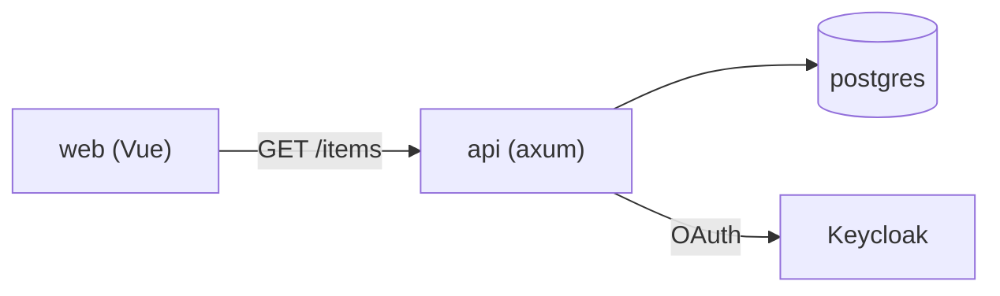

# Diagrams

Diagrams are fenced ` ```mermaid ` blocks written inside the page, next to
the text that explains them. Never separate `.mmd` files.

## Three perspectives

Borrowed from oh-my-mermaid: look at the system through several lenses, each
with its own diagram.

| Perspective | Diagram | Goes in |
| --- | --- | --- |
| Structure: the parts and who talks to whom | `flowchart LR` | `index#architecture`, `components/<name>#internals` |
| Data flow: what happens during one operation | `sequenceDiagram` | `components/<name>#flows`, one per main flow |
| External integrations: what a part calls outside itself | `flowchart LR` | `components/<name>#resources` |

Add a data model (`erDiagram` for persisted tables, `classDiagram` for
exchanged types) in `#data-model` only when the code actually defines one.

## Decomposition

- Start at the top: `index#architecture` shows each component as one node,
  plus external systems (database, third-party APIs, the browser).
- A node gets its own diagram (in its page's `#internals`, or a sub-page under
  `components/<name>/`) only when a reader can't understand it from a sentence.
- Stop decomposing when a node needs no diagram to understand.
- More than about 15 nodes in one diagram: split it. Move a `subgraph` out to
  its own `#internals` block or sub-page and leave one node pointing there.

## Rules

- Labels use real names from the code: crate, module, handler and table
  names, so a reader can grep for them.
- Every diagram has one sentence above it saying what it shows.
- Standard Mermaid 11 syntax. No `%%{init}%%` or theme directives: the IDP
  owns the look.
- Quote labels that contain punctuation, spaces with parentheses, or slashes:
  `api["api (axum)"]`, `r["GET /items"]`.
- Node ids are short and stable (`api`, `db`, `web`); a re-run should produce
  the same ids for the same parts so the diff stays small.
- Sequence diagrams name participants after components or external systems,
  and messages after real calls: `api->>db: SELECT items`.

## Example


